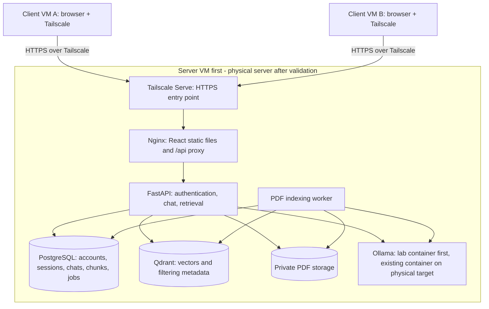

# Smart Learning System

A Computer Networks project: a centralized, privately hosted AI learning platform serving multiple students over Tailscale. Students have separate accounts, conversations, PDFs, and document retrieval contexts.

**Status:** architecture planning. This repository does not contain a runnable application yet.

## Deployment decisions

- Stage 1: validate the complete system in three VMs: one Ubuntu server VM and two client VMs.
- The server VM runs the application, databases, private storage, and its own Ollama container. The lab does not depend on the physical server for inference.
- Each client VM has a browser and Tailscale and uses a separate student account.
- Stage 2: after lab acceptance, deploy the same application stack to the dedicated physical server.
- Physical target: Ubuntu 26.04 LTS with CasaOS, Intel Core i9-9900K, 32 GB RAM, and NVIDIA RTX 2080 Ti, as reported by the server owner.
- On the physical target, reuse the existing Ollama Docker container on port 11434 rather than creating a second inference service.
- HTTPS access within the tailnet. No public website or Tailscale Funnel in the initial deployment.

Server configuration, GPU utilization, available disk space, and installed model versions have not yet been inspected remotely.

## Architecture

See [the architecture plan](docs/architecture.md) for boundaries, flows, API outline, implementation phases, and acceptance checks.

## Course requirements

The supplied screenshot requires one server, at least two clients, at least three VMs, and at least five client-server scenarios. Physical computers are listed as a bonus in addition to the VM setup.

The agreed first stage uses the required topology: one server VM and two client VMs. Record at least five successful client-server scenarios in this environment before deploying to the physical server. Retain the VM setup and evidence for assessment. A later physical-client demonstration can supplement the VM demonstration for the bonus.

## First-version features

- Student login/logout and separate private workspaces.
- General AI chat and persistent conversation history.
- PDF upload, asynchronous indexing, and processing status.
- Document list, rename, authorized view/download, deletion, and indexing retry.
- Attach/detach indexed documents to individual conversations.
- Document-grounded answers with filename and page references.
- Concurrent client access with isolated student contexts and bounded inference capacity.

Professor roles, shared course documents, OCR, internet search, and autonomous agents are outside the first version.

## Repository safety

Do not commit credentials, Tailscale keys, real student PDFs, conversation data, database dumps, model weights, or server state. Deployment configuration will use environment variables and persistent Docker volumes.
