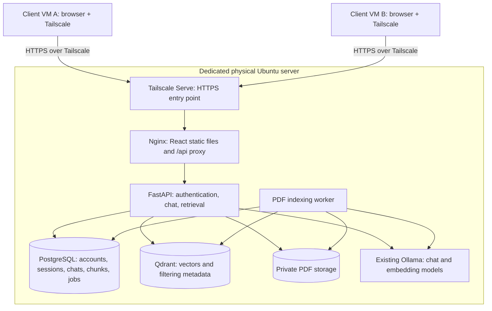

# Smart Learning System

A Computer Networks project: a centralized, privately hosted AI learning platform serving multiple students over Tailscale. Students have separate accounts, conversations, PDFs, and document retrieval contexts.

**Status:** architecture planning. This repository does not contain a runnable application yet.

## Deployment decisions

- Dedicated physical server, not a server VM.
- Ubuntu 26.04 LTS and CasaOS, as reported by the server owner.
- Intel Core i9-9900K, 32 GB RAM, NVIDIA RTX 2080 Ti.
- Existing Ollama Docker container on port 11434; reuse it rather than creating a second inference service.
- At least two separate client VMs, each with a browser and Tailscale, simulate different students.
- HTTPS access within the tailnet. No public website or Tailscale Funnel in the initial deployment.

Server configuration, GPU utilization, available disk space, and installed model versions have not yet been inspected remotely.

## Architecture

See [the architecture plan](docs/architecture.md) for boundaries, flows, API outline, implementation phases, and acceptance checks.

## Course requirements

The supplied screenshot requires one server, at least two clients, at least three VMs, and at least five client-server scenarios. Physical computers are listed as a bonus in addition to the VM setup.

The chosen physical server plus two client VMs meets the server/client count but does **not** meet the literal three-VM requirement. Instructor acceptance of this substitution is unresolved. Do not claim full rubric compliance until that is confirmed or a separate compliant VM topology is agreed.

## First-version features

- Student login/logout and separate private workspaces.
- General AI chat and persistent conversation history.
- PDF upload, asynchronous indexing, and processing status.
- Document list, rename, authorized view/download, deletion, and indexing retry.
- Attach/detach indexed documents to individual conversations.
- Document-grounded answers with filename and page references.
- Concurrent client access with isolated student contexts and bounded inference capacity.

Professor roles, shared course documents, OCR, internet search, and autonomous agents are outside the first version.

## Repository safety

Do not commit credentials, Tailscale keys, real student PDFs, conversation data, database dumps, model weights, or server state. Deployment configuration will use environment variables and persistent Docker volumes.
